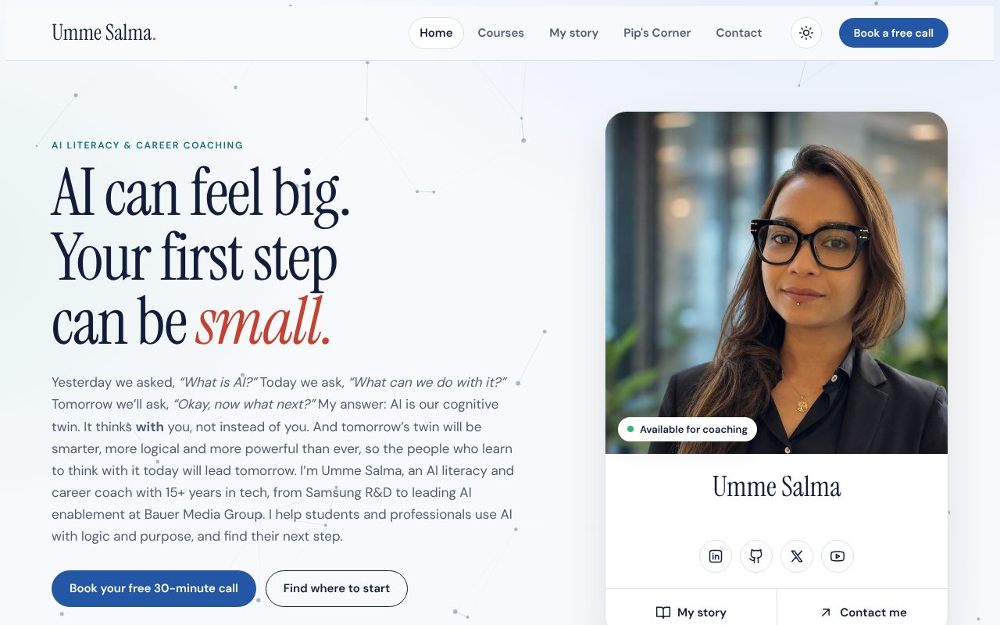
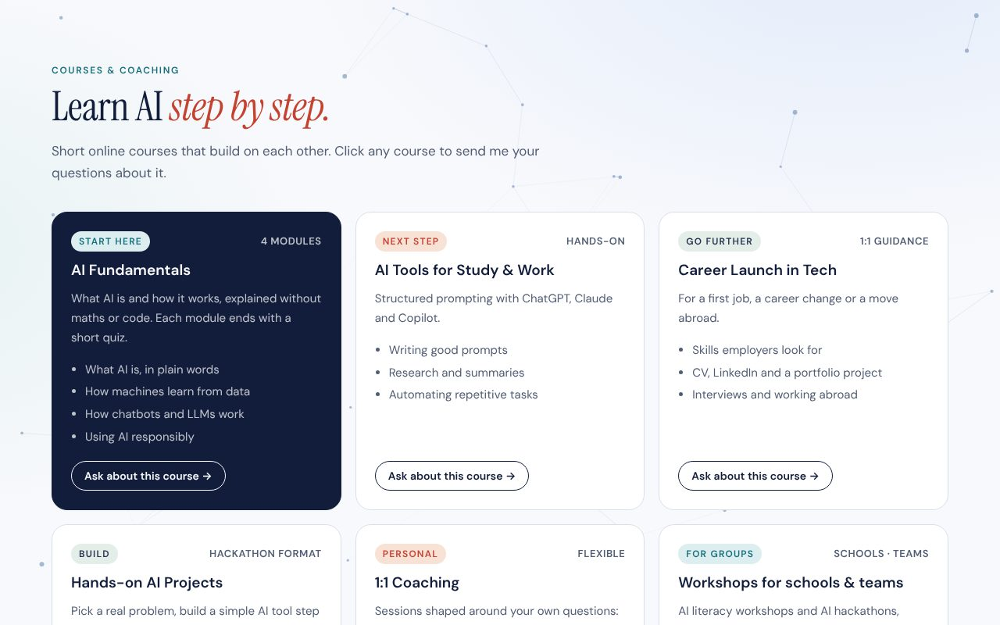
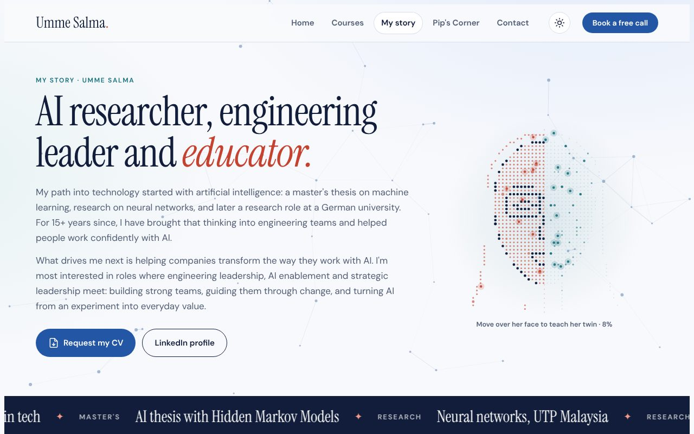
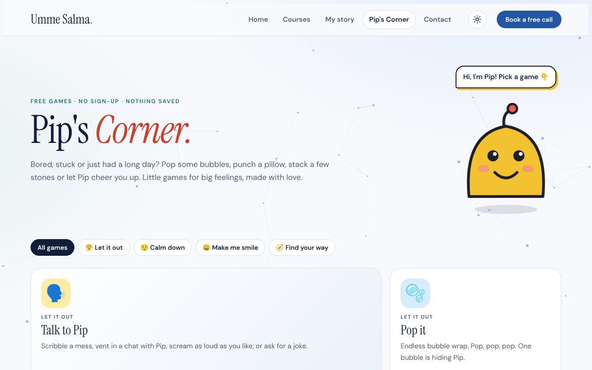
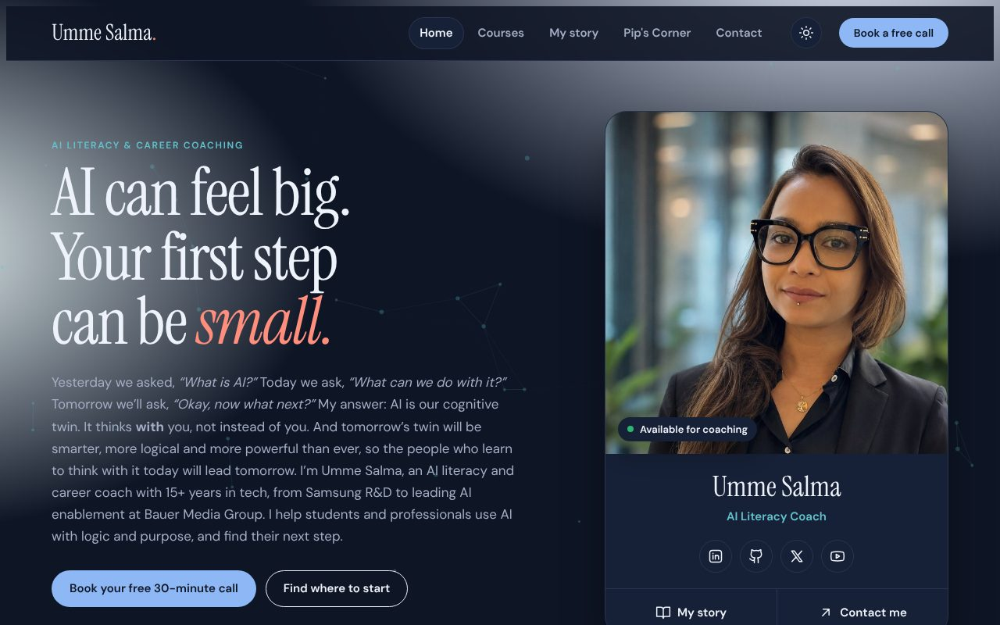
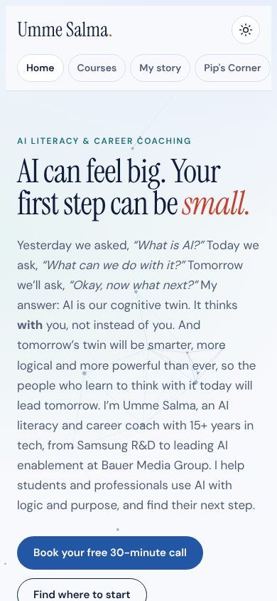
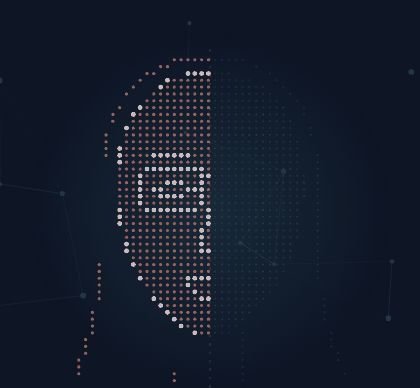

<div align="center">

# Umme Salma · AI literacy & career coaching website

**"Okay, now what next?"**
A calm, clean website that helps students and professionals take their first step with AI,<br>and tells my own story from AI research to engineering leadership.

🌐 **Live website:** [okaynowwhatnext.com](https://okaynowwhatnext.com) *(launching soon)*  ·  🎮 **Free games:** [Pip's Corner](https://ummesalma10.github.io/pips-corner/)

</div>



## 💡 The idea

> Yesterday we asked, *"What is AI?"* Today we ask, *"What can we do with it?"*
> Tomorrow we'll ask, *"Okay, now what next?"*
>
> My answer: **AI is our cognitive twin.** It thinks *with* you, not instead of you.

AI can feel big. This website makes the first step small. Visitors pick the sentence that sounds like them, and the site points them to the course that fits.

## 🧭 What's inside

| Page | What visitors find there |
|---|---|
| **Home** | A short intro, "Which of these sounds like you?" to find the right starting point, highlights from my career, and a door to Pip's Corner. |
| **Courses** | Short online courses that build on each other, from AI basics to building your own AI project. |
| **My story** | My path for recruiters and partners: AI research, 15+ years in tech, AI enablement and leadership. With an interactive half-human, half-AI particle face. |
| **Pip's Corner** | 10 free little games for big feelings, with Pip the mascot. |
| **Contact** | Book a free 30-minute call, in English or Bangla. |

## 🎓 Courses & coaching

- **AI Fundamentals:** what AI is and how it works, explained without maths or code.
- **AI Tools for Study & Work:** structured prompting with ChatGPT, Claude and Copilot.
- **Career Launch in Tech:** for a first job, a career change or a move abroad.
- **Hands-on AI Projects:** build a simple AI tool and finish with a portfolio project.
- **AI-Native Testing:** quality engineering rebuilt for the AI era (agents, Playwright, evals, CI/CD).
- **1:1 Coaching** and **Workshops for schools & teams**, based on the AI hackathon programme I founded at Bauer Media Group.

## 📸 Screenshots

| Courses | My story |
|---|---|
|  |  |
| **Pip's Corner** | **Dark mode** |
|  |  |

<p align="center"><br><sub>Works on phones too</sub></p>

## ✨ Highlights

<p align="center"><br><sub>The cognitive twin on My story: move over her human half and the dots build her AI twin.</sub></p>

- 🌗 **Light and dark mode** with one click.
- 🧠 **Interactive "cognitive twin" face** on My story, built from particles that react to your mouse.
- 🎮 **10 built-in games** in Pip's Corner, each one small and self-contained.
- 📱 **Responsive**, from phones to large screens.
- ♿ **Accessible:** keyboard friendly, readable contrast, respects "reduce motion".
- 🔒 **Privacy friendly:** no cookies, no tracking.
- ⚡ **Fast and simple:** plain HTML, CSS and JavaScript. No frameworks, no database, no build step.

## 📁 Project structure

```
okaynowwhatnext-website/
├── index.html      ← the whole website (all pages, styles and scripts)
├── images/         ← photos used on the site
├── tools/          ← the 10 Pip's Corner games, one file each
└── screenshots/    ← pictures for this page
```

To try it yourself, download the project and open `index.html` in any browser.

## 👩‍💼 About me

I'm **Umme Salma**, an AI literacy & career coach and Head of Quality Engineering with **15+ years in tech**. My path started with artificial intelligence: a master's thesis on machine learning, research on neural networks, and later a research role at a German university. Today I help people and teams work confidently with AI.

[GitHub profile](https://github.com/UmmeSalma10) · [LinkedIn](https://www.linkedin.com/in/ummesalmaeiti)

---

<sub>© 2026 Umme Salma. All rights reserved. Contact details and legal pages are kept on the live website only.</sub>
